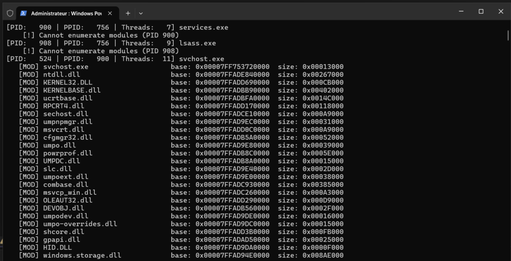

# Lab 1.3 : Toolhelp32 lab
**Series:** Windows Internals
**Environment:** Windows 11 Enterprise VM · Proxmox · isolated (no internet)

---

## What this lab is about

The goal of this is to be able to list processes and their modules.

---

---

## What i built for this

To be able to achieve that goal, i built a program that uses the <tlhelp32.h> (a ToolHelp32 library).
[toolhelp32.c]

---

---

## What's this code is doing ?

The ListModules function create a snapshot of a process, lists all his modules and display each module's name, base adress in memory and size.

In the main function, we start by taking a snapshot of processes running then we declare the PROCESSENTRY32 variable (pe) that we will use to write processes data and display them. In the loop, we iterate through each process that we took in the snapshot, write their PID, PPID, number of threads and their name, then we call ListModules.

---

---

## Let's run the program

We can see that for some process, we cant iterate through their modules, for example for lsass.exe, services.exe, MsMpEng.exe and others. This is a security measures (PPL protection, session isolation, high level integrity) to avoid a malicious code to enumerate some sensitive process.

---

---

## Offensive and defensive POV

From an offensive POV, this tools can help us know the PID of the target process, know the base address of their modules (kernel32.dll for example, very important one), in order to achieve a potential injection.

On the other side, from a defensive POV, even if process/modules enumeration is not doing much noise, if there is the chain attack of enumerate -> open process -> write memory process -> CreateRemoteThread, a SOC will correlate this information and raise an alert trigger by Sysmon event ID 10 (Process Access) for the OpenProcess steps and Event ID 8 (CreateRemoteThread) for the thread injection.

---