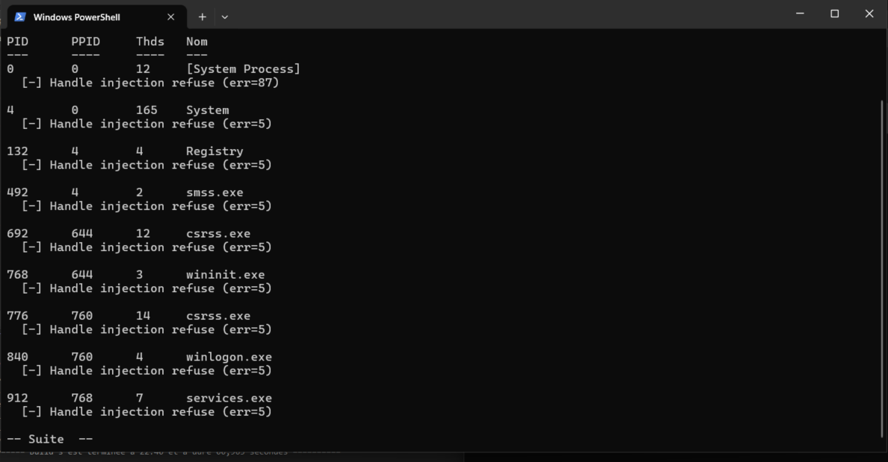
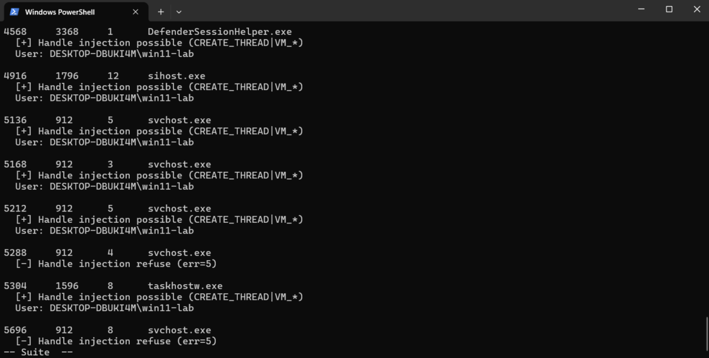
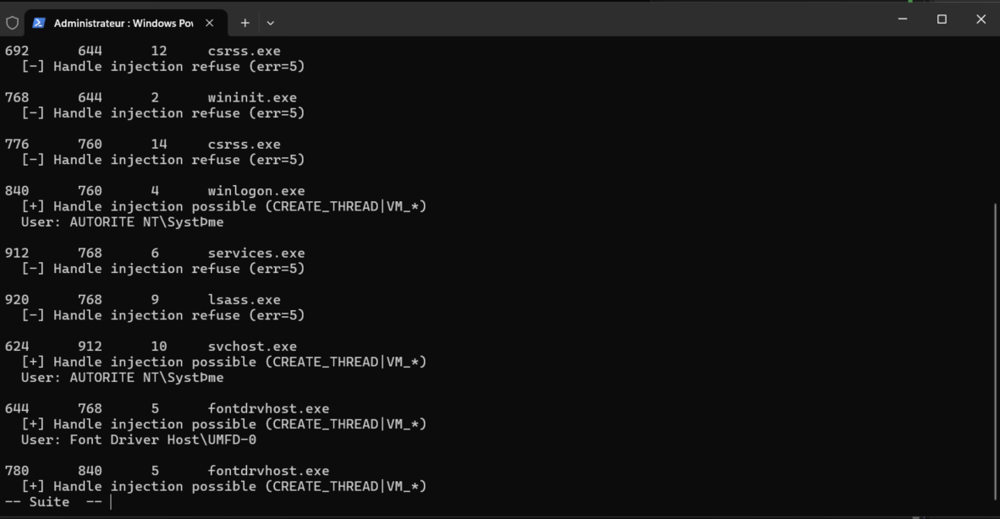

# Lab 1.1 : Windows Process Anatomy

**Series:** Windows Internals
**Environment:** Windows 11 Enterprise VM · Proxmox · isolated (no internet)

---

## What this lab is about

Before injecting code into a process, i need to understand what a process actually is at the kernel level. This lab is about observing and enumerating Windows processes from the inside ; their memory layout, security token, and handle rights using both Process Hacker and a custom C tool.

---

## What I built

`enum_proc.c` - a process enumerator using the Toolhelp32 API that:
- Lists all running processes (PID, PPID, thread count, image name)
- Resolves the owner username via the process token (`OpenProcessToken` → `LookupAccountSid`) if it is possible
- Probes whether an injection-level handle can be opened on each process (`PROCESS_QUERY_INFORMATION | PROCESS_CREATE_THREAD | PROCESS_VM_*`)

---

## Key observations

**Admin ≠ all-powerful.**  
Even running as Administrator, several system processes return `err=5` (ACCESS_DENIED). PPL-protected processes and kernel processes (`System`, PID 4) resist `OpenProcess` regardless of admin rights. `SeDebugPrivilege` is the level above that.

**Execution _without admin_ terminal**
--------------------------------------

**Execution _with admin_ terminal**
-----------------------------------

**`PROCESS_ALL_ACCESS` is an IOC.**  
The tool deliberately requests only the five rights needed for injection, not `PROCESS_ALL_ACCESS`. Every unnecessary right is noise for an EDR. I will do the test in some lab later to actually see how edr detection i sworking.

**Toolhelp32 for process discovery.** 
As mentionned in the MITRE ATT&CK T1057, we know that adversaries use some Native API output like the CreateToolhelp32Snapshot to extract information about processes. The snapshot freezes the system state at a single point in time, without it, processes starting or exiting during enumeration could cause inconsistent reads,a classic race condition.

---

## References

- *Windows Internals, 7th Ed.*
- [MSDN — PROCESSENTRY32](https://learn.microsoft.com/en-us/windows/win32/api/tlhelp32/ns-tlhelp32-processentry32)
- [MSDN — OpenProcess access rights](https://learn.microsoft.com/en-us/windows/win32/procthread/process-security-and-access-rights)
- [MITRE ATT&CK T1057](https://attack.mitre.org/techniques/T1057/)