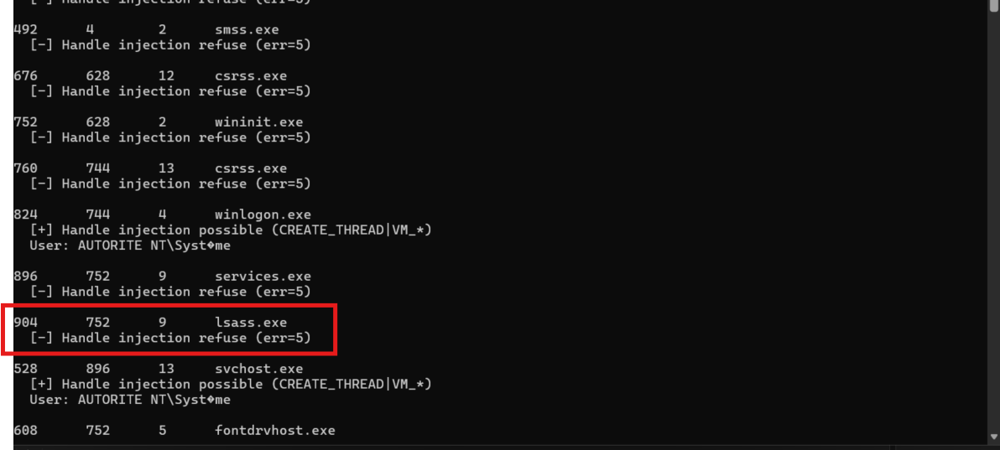
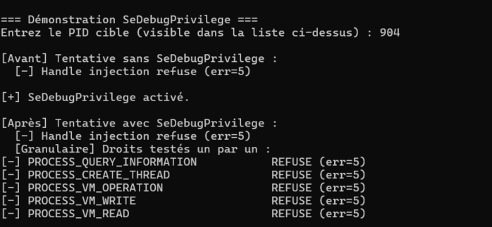
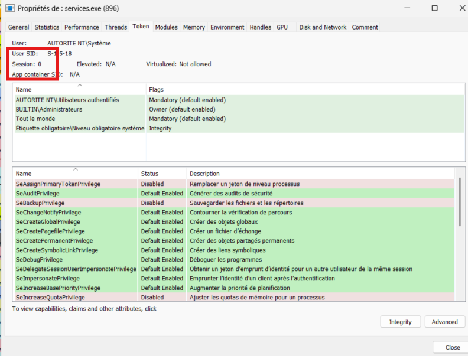

# Lab 1.1 : Windows Process Anatomy

**Series:** Windows Internals
**Environment:** Windows 11 Enterprise VM · Proxmox · isolated (no internet)

---

## What this lab is about

Before injecting code into a process, i need to understand what a process actually is at the kernel level. This lab is about observing and enumerating Windows processes from the inside ; their memory layout, security token, and handle rights using both Process Hacker and a custom C tool.

---

## What I built

`enum_proc.c` - a process enumerator using the Toolhelp32 API that:
- Lists all running processes (PID, PPID, thread count, image name)
- Resolves the owner username via the process token (`OpenProcessToken` → `LookupAccountSid`) if it is possible
- Probes whether an injection-level handle can be opened on each process (`PROCESS_QUERY_INFORMATION | PROCESS_CREATE_THREAD | PROCESS_VM_*`)

---

## Key observations

**Admin ≠ all-powerful.**  
Even running as Administrator, several system processes return `err=5` (ACCESS_DENIED). PPL-protected processes and kernel processes (`System`, PID 4) resist `OpenProcess` regardless of admin rights. `SeDebugPrivilege` is the level above that.

**Execution _without admin_ terminal**
--------------------------------------


**Execution _with admin_ terminal**
-----------------------------------


**`PROCESS_ALL_ACCESS` is an IOC.**  
The tool deliberately requests only the five rights needed for injection, not `PROCESS_ALL_ACCESS`. Every unnecessary right is noise for an EDR. I will do the test in some lab later to actually see how edr detection is working.

**Toolhelp32 for process discovery.** 
As mentionned in the MITRE ATT&CK T1057, we know that adversaries use some Native API output like the CreateToolhelp32Snapshot to extract information about processes. The snapshot freezes the system state at a single point in time, without it, processes starting or exiting during enumeration could cause inconsistent reads,a classic race condition.

---

## Update : SeDebugPrivilege & Granular Rights Probing

### What i added
Two additions to `enum_proc.c`:

* `EnableSeDebugPrivilege()` : activates SeDebugPrivilege in the current 
  process token via `AdjustTokenPrivileges`
* `ProbeHandleRightsGranular()` : tests each injection right individually 
  (`PROCESS_QUERY_INFORMATION`, `PROCESS_CREATE_THREAD`, `PROCESS_VM_*`) 
  instead of requesting them all at once

### Expected result (theory)
SeDebugPrivilege bypasses the DACL check during `OpenProcess`. Expected behavior : ACCESS_DENIED before activation -> handle obtained after.

### Observed result

**lsass.exe**



```
[Granular]
[-] PROCESS_QUERY_INFORMATION (err=5)
[-] PROCESS_CREATE_THREAD REFUSED (err=5)
[-] PROCESS_VM_OPERATION REFUSED (err=5)
[-] PROCESS_VM_WRITE REFUSED (err=5)
[-] PROCESS_VM_READ REFUSED (err=5)
...
```

## Why : multiple layers of protection

The actual protection stack on Windows 11 is deeper than that :

│
▼
PPL : Protected Process Light (lsass)
lsass runs as PPL type=ProtectedLight, signer=Lsa (0x41)
The kernel refuses dangerous rights regardless of SeDebugPrivilege
VM_WRITE, VM_READ, CREATE_THREAD → blocked
│
▼
Session 0 Isolation (services.exe)
services.exe runs in Session 0 the isolated session for
system services, separated from interactive user sessions.
Introduced in Windows Vista to prevent UI interaction between
services and users (a classic XP attack vector).
Side effect : additional inter-session access restrictions
block dangerous rights from a user session, even with
SeDebugPrivilege active 



**What Debug Privilege actually bypasses:** only the standar DACL of unprotected processes. Once a process has a kernel-level protection (PPL) or session isolation, SeDebugPrivilege is not enough.

**What the granular probe reveals :** even on `services.exe`, all five injection rights are refused, including `PROCESS_QUERYçINFORMATION`. 
Session 0 isolation blocks even read-only access from a user session, regardless of SeDebugPrivilege being active.

## References
* [MSDN — PROCESSENTRY32](https://learn.microsoft.com/en-us/windows/win32/api/tlhelp32/ns-tlhelp32-processentry32)
* [MSDN — OpenProcess access rights](https://learn.microsoft.com/en-us/windows/win32/procthread/process-security-and-access-rights)
* [MSDN — Privilege Constants](https://learn.microsoft.com/en-us/windows/win32/secauthz/privilege-constants)
* [MSDN — Protecting Anti-Malware Services (PPL)](https://learn.microsoft.com/en-us/windows/win32/services/protecting-anti-malware-services-)
* [MSDN — Session 0 Isolation](https://learn.microsoft.com/fr-fr/previous-versions/windows/hardware/design/dn653293(v=vs.85))
* [itm4n — Do You Really Know About LSA Protection?](https://itm4n.github.io/lsass-runasppl/)
* [MITRE ATT&CK T1057](https://attack.mitre.org/techniques/T1057/)
* [MITRE ATT&CK T1134.001](https://attack.mitre.org/techniques/T1134/001/)
* [MITRE ATT&CK T1003.001](https://attack.mitre.org/techniques/T1003/001/)
* Windows Internals, 7th Ed.

