# Lab 1.2 : First Debugger
**Series:** Windows Internals
**Environment:** Windows 11 Enterprise VM · Proxmox · isolated (no internet)

---

## Whats this lab is about

In this lab, we're trying to figure out what's happening when we are running a program (called Lab 1.2.exe in this lab) in Windows. This lab is about using x64dbg to try to have a better understanding of what's going on when I run this process.

---

---

## What i built for this

Just a little "Hello World" C program, the objectives here is really not to start with a BIG  program where i'm just going to be lost later haha.

--------------------------------------
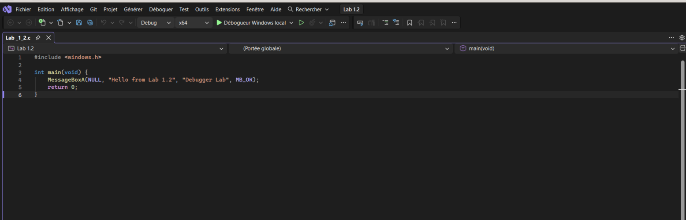

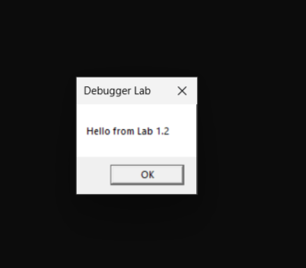

---

---

## First step : breakpoints

So the first step here was to find the break points where my actual code is starting, but i noticed that my code was not being loaded at the first loading point. My first question when i saw that was "Why my code is not starting on the first breakpoint we encounter ?", we'll see why in just a moment.
We also have some key indicators like RDX="Hello from Lab 1.2", R8="Debugger Lab", RCX=NULL, R9=0 and RIP that pointing towards user32.MessageBoxA. This follows the Microsoft x64 calling convention: the first four arguments are passed in RCX, RDX, R8 and R9.

--------------------------------------
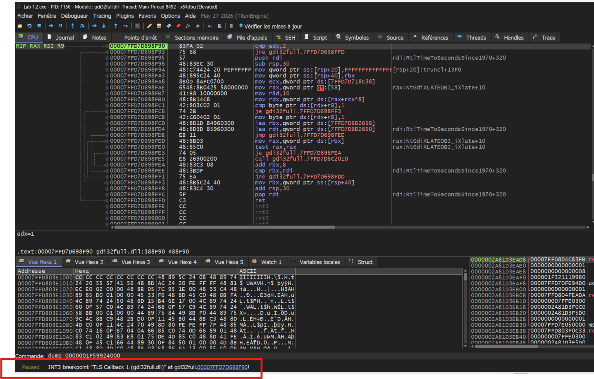
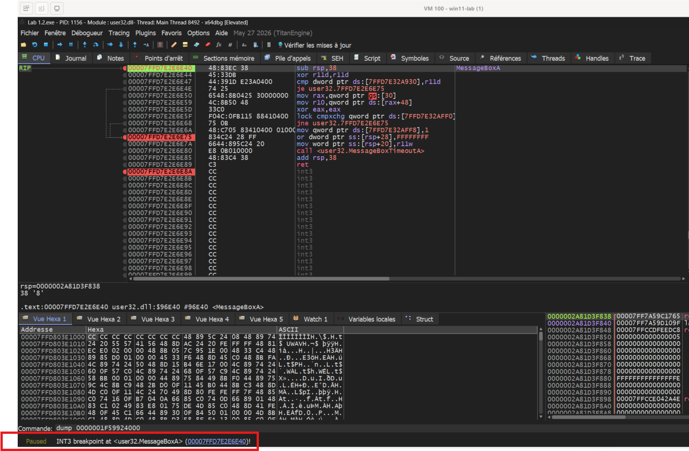
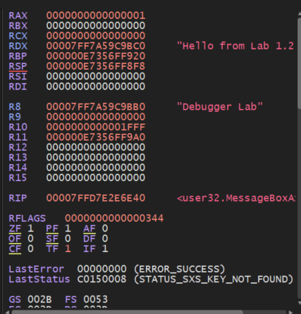

---

---

## Second step : ntdll.dll

For this step we can go on the "Call Stack" tab or "Pile d'appels" in french ( as we can see on these screenshots below). In this we see the order of execution of the process, especially the fact that ntdll.dll is called in a first place. WHat is ntdll.dll ? It is a dll that windows map in your process memory before anything else : ntdll.dll is a loader, it resolves dépendancies and loads dll in the right order.
On the images below we can see that the kernel is starting the threads by calling ntdll in a first place (Utilisantdll.Rt....), then the CRT ( C Runtime) initializes, CRT calling main function, then my code ( +39 bytes after the starting of main function).

--------------------------------------
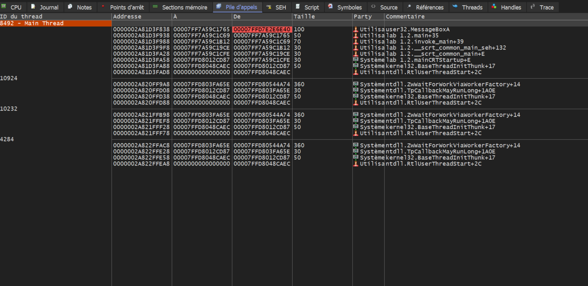

---

---

## Final step (for this lab)

Now we want to find the address of the PEB. This can be done by going on the "Threads" then find the TEB address of the main Threads. 

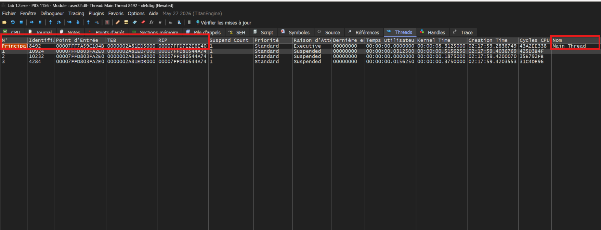

Once we have this address, we can dump this address in command and add "+60" (the pointer to the PEB is located at offset 0x60 of the TEB (GS:[0x60] on x64, FS:[0x30] on x86)) and go to the location of this entry point. GS[0x60] (or FS[0x30] for x32) allow us to find the address of the PEB and then be able to see where the dlls are loaded. That's why shellcode uses this  : access the PEB without hardcoded address, resist to ASLR.

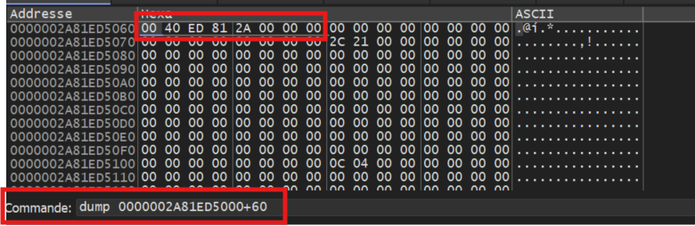

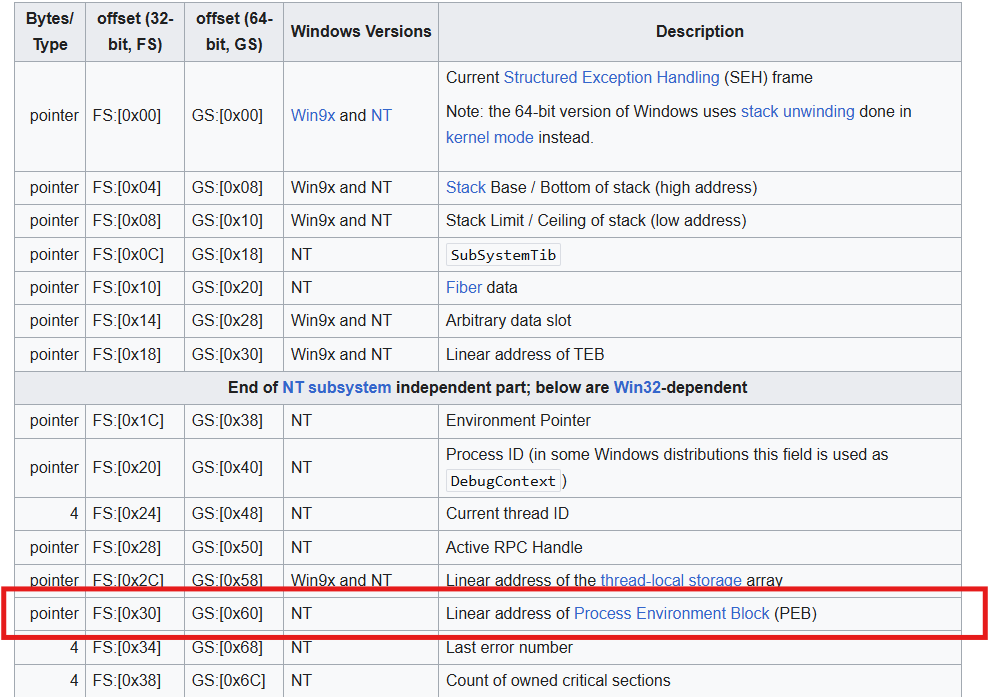

Then we can dump to this address to find the Flag 0x01 (BeingDebugged). This flag is really important because it can be used for both offensive and defensive purpose. Offensive : make a malware seems harmless, if the malware detect this flag it will just stop the process. Defensive : turn this flag to 0x00 then the malware will continue to operate and we will be able to observe his behavior and purpose. 
In order to dump the PEB address, we have to write the address using Little-Endian (the least significant byte is stored first). In this example "00 40 ED 81 2A 00 00 00" turns to "00 00 00 2A 81 ED 40 00"

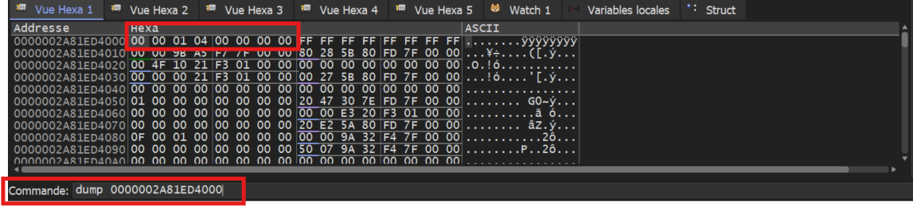

Here it is ! We can the 0x01 flag at PEB + 0x02. This flag can either be on 0x00 or 0x01.

## Detection

From a defensive/edr detection pov, they're trying to detect who's calling the IsDebuggerPresent or trying to attach a debugger on a critical process, from that they're raising an alert, because most of program do not need these accesses.
IsDebuggerPresent() directly reads the BeingDebugged byte at PEB+0x02 and returns its value. We can see the struc of PEB below :

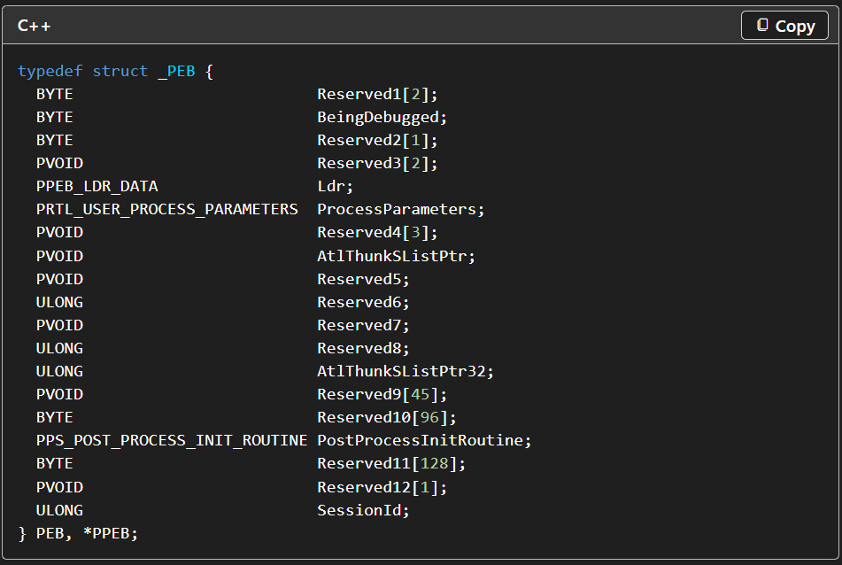

---