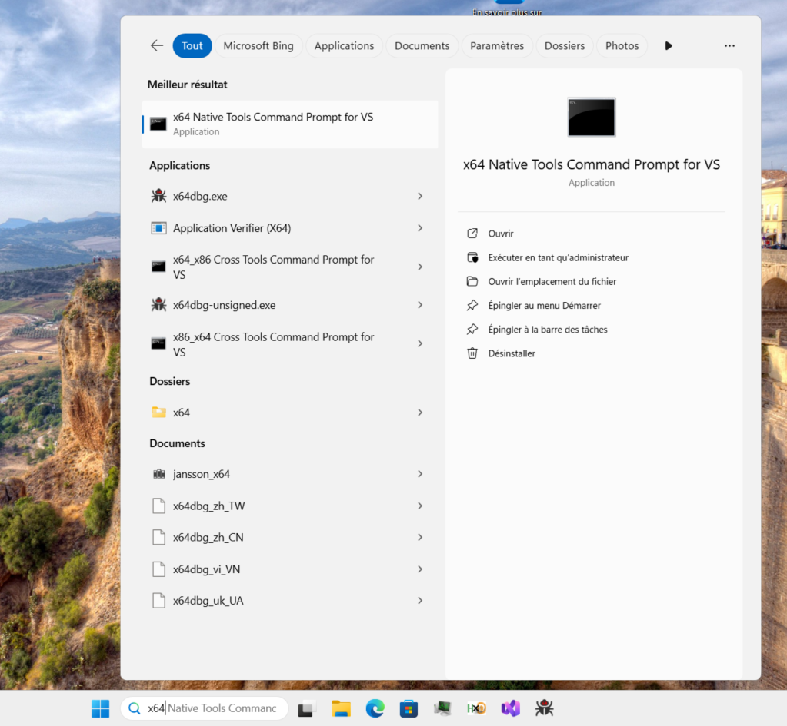
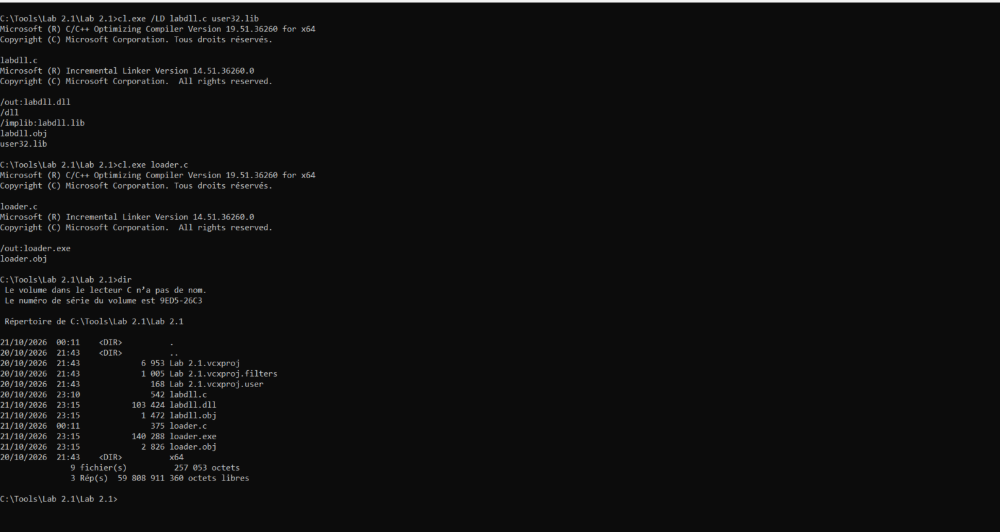
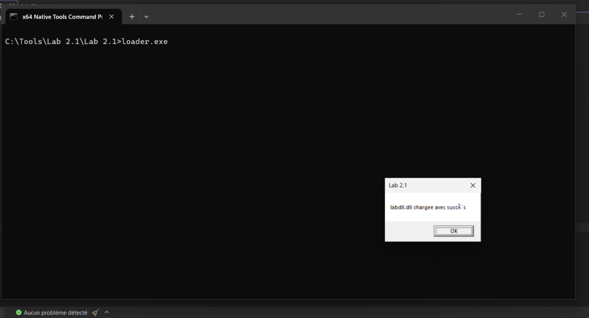
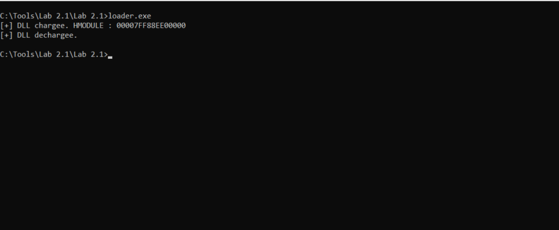
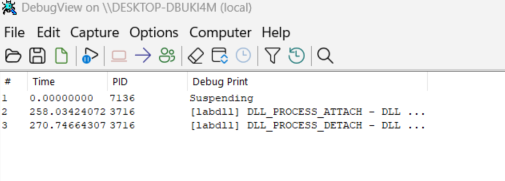

# Lab 2.1 : Understanding DLLMain
**Series:** Windows Internals
**Environment:** Windows 11 Enterprise VM · Proxmox · isolated (no internet)

---

## What this lab is about 

In this lab we learn how to compile a dll and charge it into a process. We observe when it is attached and detached as well as the address given to it. 

---

---

## What i built

For this lab we have to code : the dll (labdll.c, will be compile labdll.dll) and the process (loader.c, will be compile in loader.exe). 
Labdll.c is a simple code that generate a simple dll that will display a MessageBox once loaded in a process.
Loader.c is also a simple code : only a main function that load "labdll.dll" with LoadLibraryA function from Windows API, after that either we get an error and print the reason with GetLastError(), or if everything is doing well we print the base address of the dll then we liberate the DLL with FreeLibrary, after that the dll will be detached.

As i using Visual Studio, to compile i will use the "x64 Native Tools Command Prompt for VS".

I will compile lab.dll with the following command "cl.exe /LD labdll.c user32.lib", LD=Link as DLL and user32.lib is necessary for MessageBoxA.
We will use "cl.exe loader.c" to compile the loader.
Now we should have two PE "labdll.dll" et "loader.exe".

---

---

## Key observation

When we launched loader.exe, we can see instantly that a MessageBox appears with the message that we put.

When we click on "OK", can see the following "[+] DLL chargee. HMODULE : [BaseAdressDLL]" : we can actually see the base adress mapped to the dll. Here is the chain of execution : dll attached → OutputDebugString → MessageBox → [click OK] → LoadLibrary returns → printf HMODULE → FreeLibrary → dll detached. On DebugView, we can actually see the moment where the dll is being attached and then detached, on which PID.

---

---

## Defensive POV

We know that an EDR can detect whether a DLL is loaded from a user-controlled or uncommon path, the tools that capture that is Sysmon Event ID 7 (Image Load). There are also concretes IOC : Unsigned DLL, DLL charged from uncommon path, etc...

---

---

## Offensive POV

In this lab we can see how we can load a dll in a process, we can think then think about loading malicious dll into legitimate processes. That trick can give us ability to execute actions in a context of another process. The T1129 (MITRE ATT&CK) is leveraging this technique : adverseries can modularize functionality of their malware into shared objects that perform various function as managing C2 network communication/beacon for example.

---