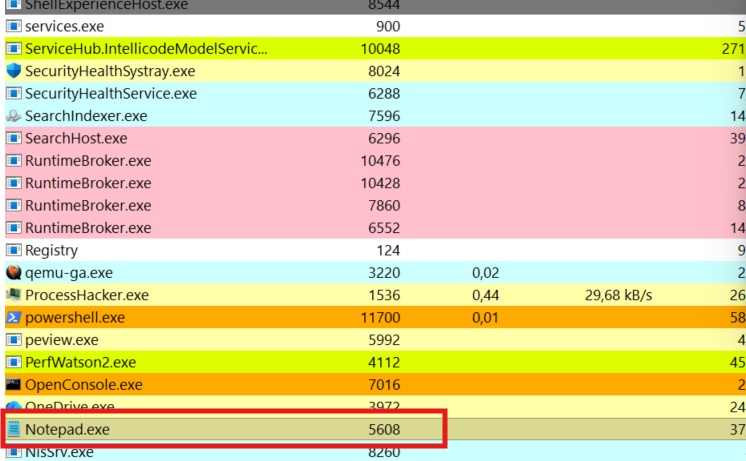
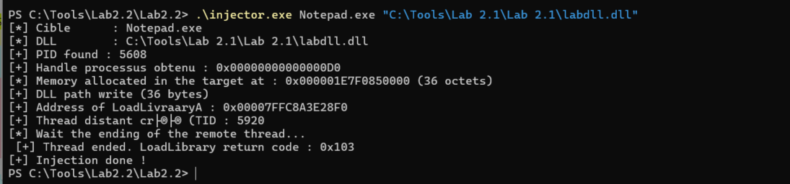
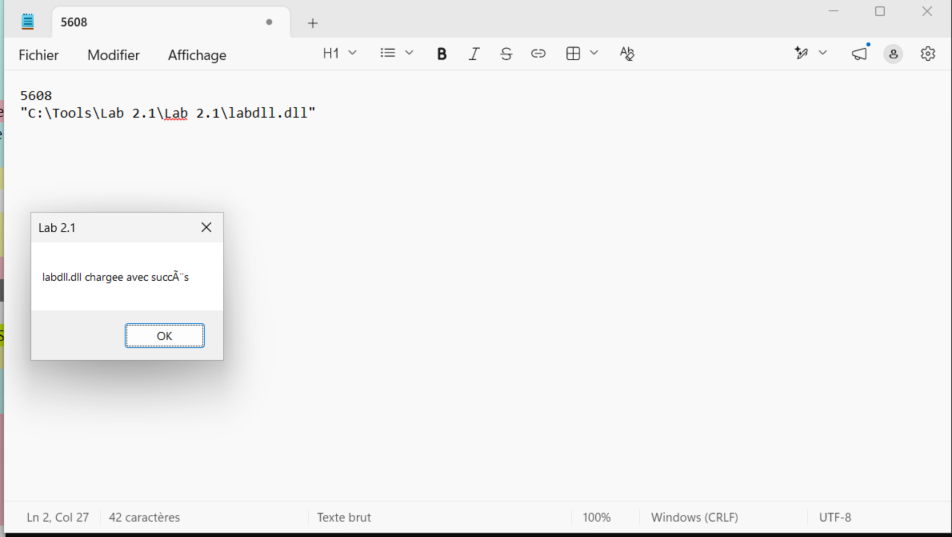
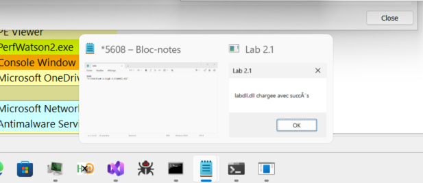
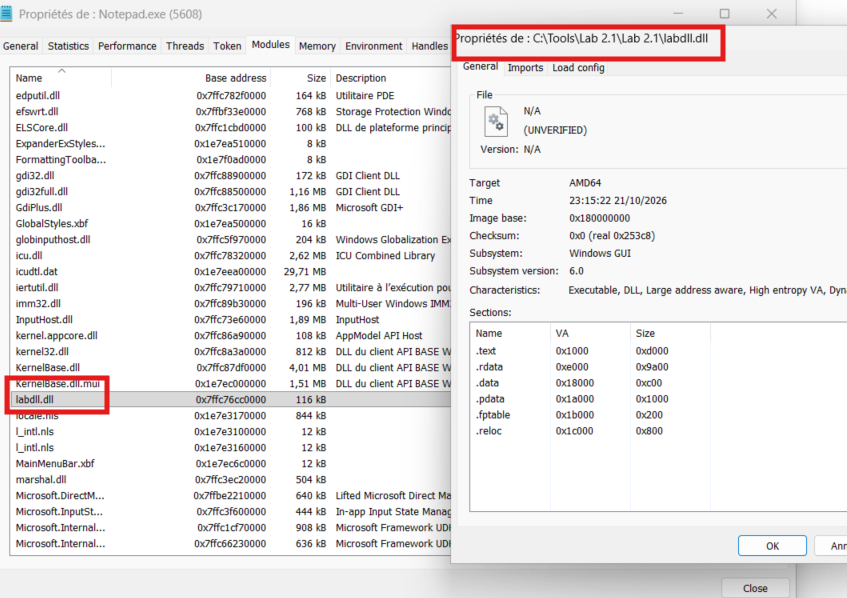
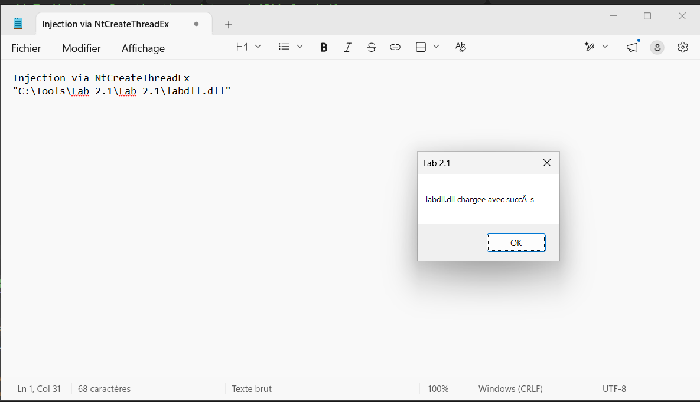
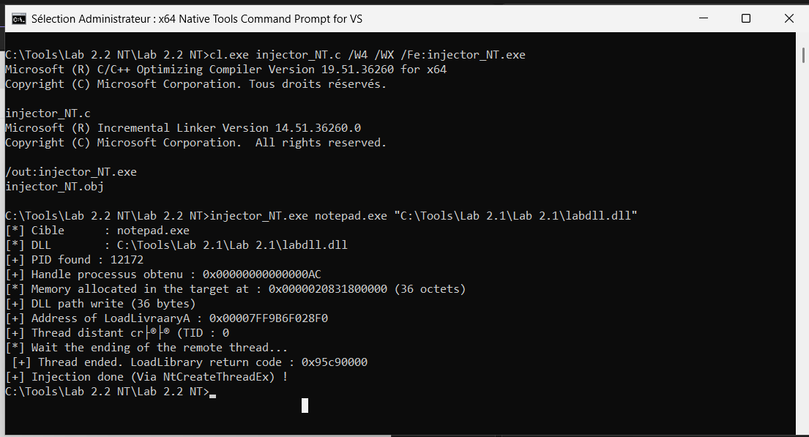

# Lab 2.2 : DLL Injection via CreateRemoteThread and NtCreateThreadEx
**Series:** Windows Internals
**Environment:** Windows 11 Enterprise VM · Proxmox · isolated (no internet)

---

## What this lab is about 

The purpose of this lab is to perform DLL injections via two ways : first we will use the Win 32 API with CreateRemoteThread, then we will do it with Native API by using the NtCreateeThreadEx, an undocumented function of "ntdll.dll". 
Let's start by explaining how the code works.

---

---

## Injector.c ( WIN32 API )

First we define de PrintLastError() function which simply serves to display errors messages with more context to have a better understanding and help us to debug.

Then we have the GetProcessIdByName() function. Here we are using the principle we saw in previous labs : we create a snapshot of processes currently running via ToolHelp32, we decalre a PROCESSENTRY variable ( a structure that contains the fields that describes a process, fields lik PID, name, PPID, Size etc...), then we will, then we will compare the name of the targeted process with each iteration of processes in the snapshot in order to find the PID of the targeted process.

In the main() function, we first start by getting the arguments that we will pass through when launching the program (injector.exe exemple.exe C:\DLL_ABSOLUTE_PATH) then we use the GetProcessIdByName in order to find the PID of the process. Then, we declare the "desiredAccess" variable that combine all the necessary ACCESS with as fex permissions as possible (it's a good practice to avoid edr detection, a "PROCESS_ALL_ACCESS" is a red flag).
Afterwards, we open the process using the permissions that we've configured, allocated memiry in this process and writing the DLL path in the memory of the target. Subsequently, we're going to pick up LoadLibraryA address (by loading kernel32.dll, windows ensures that processes started afterward in the same session map it to the same virtual address ; the Windows Memory Manager handles this through image section sharing, so LoadLibraryA is located at the same virtual address across these processes),that we will use in "hthread" in order to create the remote thread. Once the DLL is loaded in the targer process, the message box appears and VOILA, injection done. I did a test with notepad.exe, here are some of my screenshots for you to illustrate : 










Here when we open the module charged in Notepad.exe, we can find the "labdll.dll" that we injected in the process.



---

---

## Injector_NET.c ( NATIVE API )

On the side of the injector with NtCreateThreadEx, it's the same principle, we there are just a couple of things that are changing. First, we have to declare a funtion pointer type (typedef) for NtCreateThreadEx, since its signature is not available in the Windows SDK headers. I found the folloing signature when browsing online : 
```C
typedef NTSTATUS(NTAPI* pfnRtlCreateUserThread)(
	IN HANDLE ProcessHandle,
	IN PSECURITY_DESCRIPTOR SecurityDescriptor OPTIONAL,
	IN BOOLEAN CreateSuspended,
	IN ULONG StackZeroBits OPTIONAL,
	IN SIZE_T StackReserve OPTIONAL,
	IN SIZE_T StackCommit OPTIONAL,
	IN PTHREAD_START_ROUTINE StartAddress,
	IN PVOID Parameter OPTIONAL,
	OUT PHANDLE ThreadHandle OPTIONAL,
	OUT PCLIENT_ID ClientId OPTIONAL);

typedef NTSTATUS(NTAPI* pfnNtCreateThreadEx)
(
	OUT PHANDLE hThread,
	IN ACCESS_MASK DesiredAccess,
	IN PVOID ObjectAttributes,
	IN HANDLE ProcessHandle,
	IN PVOID lpStartAddress,
	IN PVOID lpParameter,
	IN ULONG Flags,
	IN SIZE_T StackZeroBits,
	IN SIZE_T SizeOfStackCommit,
	IN SIZE_T SizeOfStackReserve,
	OUT PVOID lpBytesBuffer
	);

```

Then we initiate the "NtCreateThreadEx" variable that we will use like that : 
```C
NtCreateThreadEx(&hThread, 0x1FFFFF, NULL, hProcess, (PVOID)loadLibraryAddr, remoteMem, FALSE, 0, 0, 0, NULL);
```

&hThread        -> receives the handle to the created thread (output)
0x1FFFFF        -> access rights on the created thread handle (THREAD_ALL_ACCESS)
NULL            -> default object attributes
hProcess        -> handle to the target process
loadLibraryAddr -> thread entry point (LoadLibraryA)
remoteMem       -> argument passed to LoadLibraryA (DLL path in target memory)
FALSE           -> thread starts immediately
0, 0, 0         -> stack defaults
NULL            -> debug buffer, unused

We can see the result below : 





---

---

## End

The difference between these two approaches is that `CreateRemoteThread` uses the Win32 API (`kernel32.dll`), while `NtCreateThreadEx` belongs to the Native API (`ntdll.dll`), one layer below the Win32 API and closer to the system call boundary. Maybe this makes `NtCreateThreadEx` harder to detect in some cases, especially for EDRs that mainly rely on hooks at the Win32 API level. This is just a hypothesis that I will have to verify in the next labs. 

From a defensive perspective, Sysmon Event ID 8 (CreateRemoteThread) can be relevant when monitoring remote thread creation, while Event ID 7 (ImageLoad) can help identify DLL loading in the target process, depending on the Sysmon configuration. A SOC can also monitor combinations of events to identify suspicious activity. I will test this in the next lab.

---
