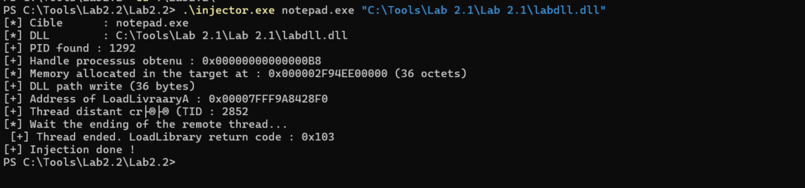
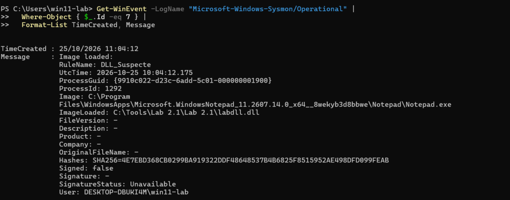
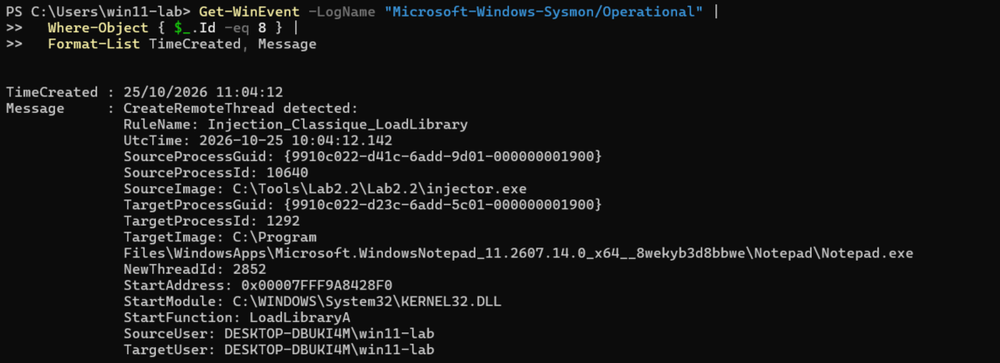
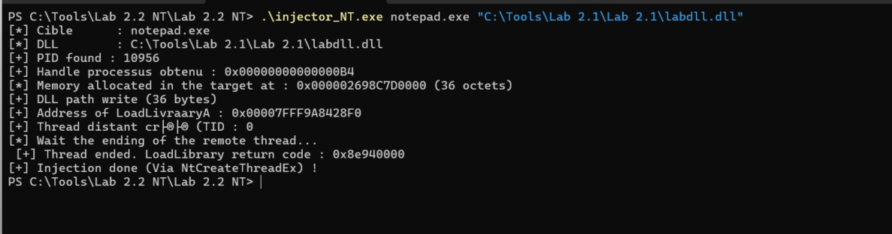
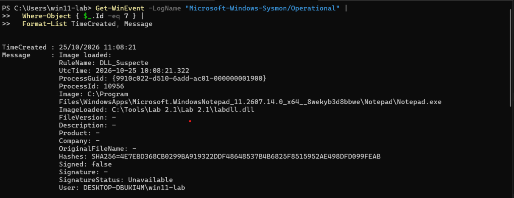
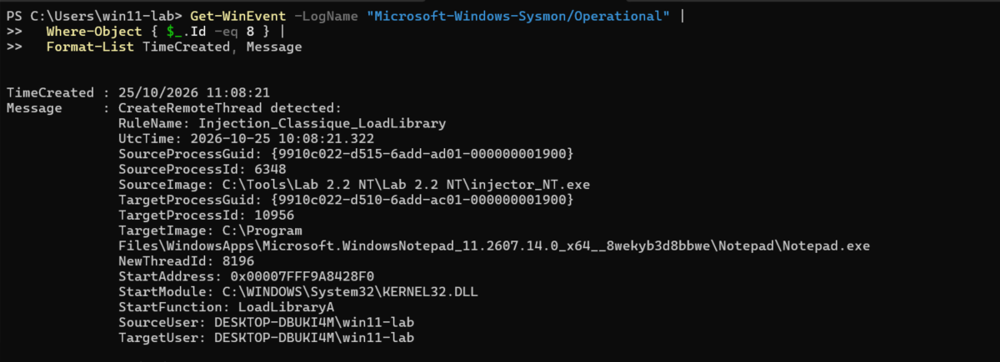

# LAB 2.3 - Defensive observation - Sysmon & DLL injection
**Series:** Windows Internals
**Environment:** Windows 11 Enterprise VM · Proxmox · isolated (no internet)

---

## Goal

The purpose of this lab is to observe how sysmon can detect the DLLs injection we previously performed in the lab 2.2, we'll see if there is a difference between CreateRemoteThread and NtCreateThreadEx at this level.
**Prerequisites**: Labs 2.1 and 2.2 completed (`labdll.dll` +`injector.exe` + `injector_NT.exe` available).
**Tools**: Sysinternals Suite (including Sysmon64),PowerShell running as an administrator.
In this write-up, we are not going to going in depth on what is sysmon i will do that in another write up.

---

---

## Let's start

First, we will create an xml file where we will add two event filter : filter for Event 7 (Image Loaded) and another filter for Event 8 (CreateRemoteThread).

```xml
<Sysmon schemaversion="4.91">
	<EventFiltering>

		<!-- Event 7 : chargement denotre DLL dans le processus ciblé -->
		<ImageLoad onmatch="include">
			<Rule name="DLL_Suspecte" groupRelation="or">
				<ImageLoaded condition="contains">labdll</ImageLoaded>
			</Rule>
		</ImageLoad>
		
		<!-- Event 8 : thread créé à distance avec LoadLibrary comme point d'entrée -->
		<CreateRemoteThread onmatch="include">
			<Rule name="Injection_Classique_LoadLibrary" groupRelation="or">
				<StartFunction condition="begin with">LoadLibrary</StartFunction>
			</Rule>
		</CreateRemoteThread>
		
	</EventFiltering>
</Sysmon>
```

### Deployment

```powershell

# Apply the config
Sysmon64.exe -c lab23-config.xml
# → Configuration updated.

# Check if the service is up
sc.exe query Sysmon64
# → STATE : 4  RUNNING

# Clean the logs
wevtutil cl "Microsoft-Windows-Sysmon/Operational"
```

## Execution

1. Open notepad.exe
2. Launch the injector : `injector.exe notepad.exe "C:\Tools\Lab 2.1\Lab 2.1\labdll.dll"`
3. The MessageBox of 'labdll.dll' appears -> OK
4. Read Sysmon's events :
```powershell
Get-WinEvent -LogName "Microsoft-Windows-Sysmon/Operational" |
Where-Object { $_.Id -eq 7 } |
Format-List TimeCreated, Message

Get-WinEvent -LogName "Microsoft-Windows-Sysmon/Operational" |
Where-Object { $_.Id -eq 8 } |
Format-List TimeCreated, Message
```







With **Event 7**, we can see that the dll is not signed and that there is no metadata, these are some IOCs of potentially malicious modules that will be directly flag by EDR or other detection system.
With **Event 8**, we can see which process injected a dll in what process. In our case, we notice the source PID, the source image (injector.exe), and the target image (notepad.exe). we also have here some important IOCs : StartModule KERNEL32.dll and StartFunction LoadLibraryA. That a proof of what we were saying in the previous lab : ernel32.dll is randomized once at boot (ASLR), then its physical image is shared across all processes in the session, so its virtual address is identical in every process within the same session.

---

---

## Test with NtCreateThreadEx

I've also tested this with the injector that is using the NtCreateThread function of ntdll.dll. The execution is pretty much the same unless we're going to use 'injector_NT.exe' from the previous lab.







**Conclusion** : NtCreateThreadEx doesn't bypass this detection. Indeed, Sysmon's callback operate **below** the Win32 layer and **below** the native syscall layer. Any thread creation, whether it goes through `CreateRemoteThread` (kernel32) or `NtCreateThreadEx` (ntdll), triggers the same kernel callback.


---

---

## Note

Dll injection is an old technique (2000-2010), in 2026 it is:
- **Detected immediately** by all modern EDR and basics Sysmon configuration
- unusable in a real context

However, the educational value is maximum. These techniques perfectly illustrates the fundamentals (VirtualAllocEx, WriteProcessMemory, CreateRemoteThread, Native API, etc...) and help us to have a better understanding on *why* advanced techniques exists and their purpose.

---


