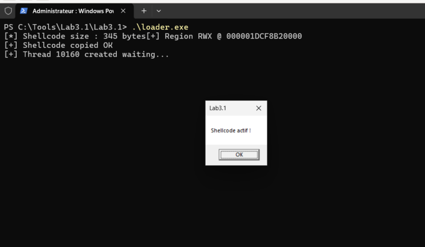
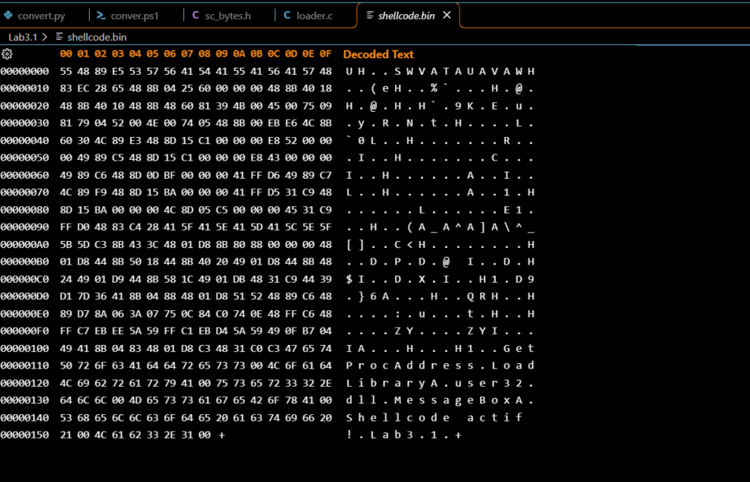
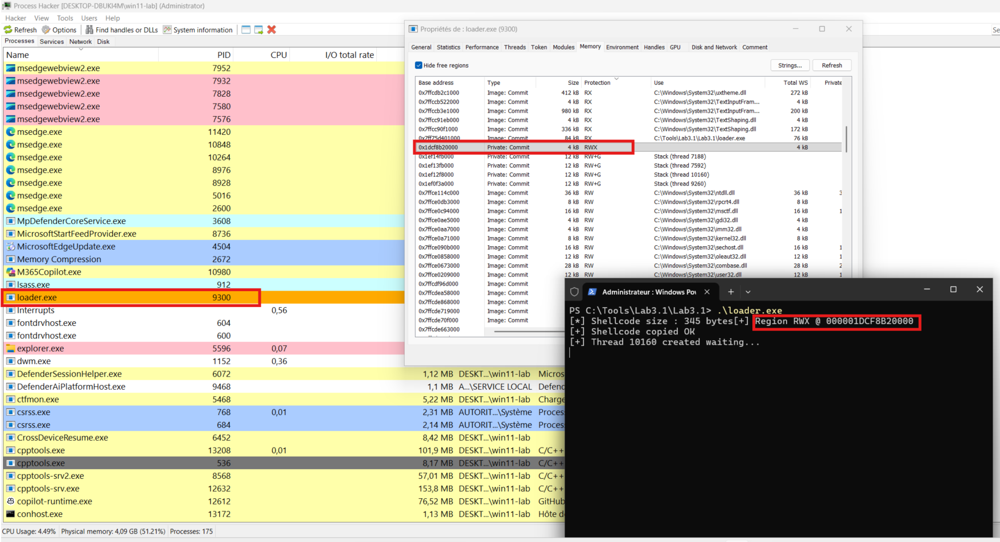

# Lab 3.1 - Homemade Shellcode : MessageBox via dynamic API resolution


## Goal

The purpose of this lab is to execute a shellcode in our own process through dynamic API resolution.


## Key concept

### Position-Independent Code (PIC)
Shellcode has to operate at any memory address ( ASLR changes it at each execution). `default rel` generates some RIP-relative references : code and data are moving together, offsets still valid.

### PEB Walk
Without IAT, shellcode finds kernel32.dll by walking through the Windows internal structures : 
GS:[0x60] -> TEB -> PEB -> Ldr -> InLoadOrderModuleList -> kernel32

### Export resolution
Once kernel32 found, the shellcode parses its Export Directory manually : AddressOfNames -> AddressOfNameOrdinals -> AddressOfFunctions -> absolute address.


## Why assembly (NASM) and not C for the Shellcode

A compiled C program produces a PE file, structured with headers, an IAT, sections, etc... Windows Loader resolves these dependencies before execution. A shellcode consists of raw, unstructured bytes, which must function without external assistance. That's why we run NASM with `-f bin`, and why the shellcode resolves its own API via PEB Walk.
Nevertheless, it is technically possible to write shellcode in C with the right compiler flags, but assembly language remains a gold standard because it provides total control over every byte produced.

Some sources more detailed : 
- https://dev.to/windasunnie/shellcode-call-calcexe-why-cannot-use-c-write-shellcode-2g84
- https://moval0x1.github.io/posts/the-peb-walk-anatomy/


## Architecture

Shellcode.asm (NASM x64, 5 blocs)
│
▼
nasm -f bin -> shellcode.bin (345 raw bytes)
│
▼
convert.ps1 -> sc_bytes.h (C array unsigned char sc[])
│
▼
cl loader.c /W4 -> loader.exe
│
▼
VirtualAlloc (RWX) -> memcpy -> CreateThread -> shellcode is executed


## Building pipeline

```
nasm -f bin shellcode.asm -o shellcode.bin
.\convert.ps1 shellcode.bin
cl loader.c /W4
.\loader.exe
```


## Code 

The complete source code with comments is available in this repo.
The key files :
    - `shellcode.asm` - the shellcode (5 blocs : prologue, PEB Walk, main body, find_export, data)
    - `convert.ps1` - generate sc_bytes.h from shellcode.bin
    - `loader.c` - allocates a RWX region, copies and executes the shellcode


## Execution




## Detection - Defensive POV

### Static IOC     : clear strings


Strings `GetProcAddress`, `LoadLibraryA`, `MessageBoxA`, `Shellcode actif !` are visible in plaintext. An AV that scans memory detects them immediately, we will see that concept again in another lab.

### Dynamic IOC    : RWX region without module


`Private: Commit RWX` region at address `0x1DCF8B20000` is visible in Process Hacker. I see three simultaneous anomalies:
    - Among the Private: Commit regions, only one stands out: RWX protection with an empty Use column. Thread stacks are also private but carry RW+G protection and are labeled accordingly.
    - `RWX` permissions is a strong IOC - legitimate DLLs usually have either `RX` or `RW` permissions, 
    - `Use` columns is empty, that means that there is no associated modules

### Behavioral IOC : user32.dll loaded without IAT


`user32.dll` appears in modules of `loader.exe` even though `loader.c` never imports it explicitly. No `#include`, no `lib` link to it, THAT WEIRD, this is a strong behavioral IOC. The shellcode loaded it itself via `LoadLibraryA` resolved dynamically, it is visible and abnormal for an EDR, which is a strong IOC.


## MITRE ATT&CK

| Technique | ID | Link to this lab |
|---|---|---|
| Reflective Code Loading | T1620 | The shellcode resolves its own dependencies without an external PE loader |
| Native API | T1106 | VirtualAlloc + CreateThread without going through the IAT |
| Embedded Payloads | T1027.009 | Bytes embedded in loader.exe with no recognizable PE header |


### Contextual notes


These techniques are well-known and detected by modern EDRs. The private RWX region
with no associated module is an anomaly immediately visible in Process Hacker and
SIEM/EDR solutions. The absence of a PE header blinds static detection, but behavioral
detection remains effective.

**The value of this lab is understanding the mechanism, not operational evasion.**